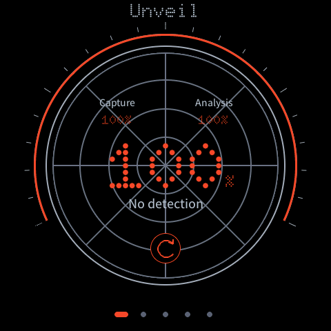

# Unveil

射频采集与分析的触摸界面。设备处理交互与图表绘制，树莓派提供采集、分析、进度和历史数据。

当前硬件：**ESP-Mosaico / ESP32-S31 / 480 × 480**。提供三种运行形式，不提供独立的 Works 下载版。

| 版本 | 运行方式 | 工程 |
| --- | --- | --- |
| Standalone 独立固件 | ESP-IDF + LVGL + 自有 Lua/任务/网络运行层，没有 Mosaico-Claw 框架 | [mosaico-standalone](firmware/mosaico-standalone/) |
| Desktop 桌面应用固件 | 保留原 Mosaico 桌面，点击圆形 Unveil 图标打开应用 | [mosaico](firmware/mosaico/) |
| Idea 应用包 | 使用 Vibe Mode 安装 `.irisfw`，切换进入 Unveil | [mosaico-idea](firmware/mosaico-idea/) |

**三个新版本均为构建候选版，尚未完成新启动路径的真机验收。** 本轮没有切换设备固件。安装和验证边界见 [版本说明](docs/distributions.md)。



## 下载

从 [Releases](https://github.com/aurevoir0216/unveil/releases) 下载带 `standalone`、`desktop`、`idea` 名称的文件。标题使用 `Unveil v0.xx`，不单独附带 SHA256 下载文件。

- 独立版 ZIP 包含自己的启动器、分区表、主程序、资源与工厂镜像，安装会替换原 Mosaico Flash 布局。
- 桌面版 ZIP 包含框架应用升级包和 NAND 配套脚本、字体与上传工具。
- Idea 为官方格式 `.irisfw` 安装包；提供文件不代表已上架官方 Ideas 商店或获得六位编号。

旧 `v0.10 / v0.11` 是基于 Mosaico 框架的专用启动版本，不能当作完全独立固件。

## 界面与数据

保留原生 LVGL 雷达、径向等宽圆盘、三类图表、实时历史、语言、主题、静音及音量设置。图表准备计入总进度；100% 呈现结果后才播放完成声音和振动。历史排序使用居中的点阵 `NEWEST / OLDEST`，不随语言切换。

Wi-Fi 和服务地址默认留空，由使用者配置。发布包不包含个人 NVS、历史、采集数据或模型权重。后端协议见 [backend.md](docs/backend.md)。

## 构建与扩展

使用固定 ESP-IDF 提交 `7b9cc1ac79f865983f59bb8ff3ff43eb74ff1dbe`，先阅读对应工程的依赖说明。

```bash
source /path/to/esp-idf/export.sh
python tools/build_mosaico.py standalone
python tools/build_mosaico.py desktop
python tools/build_mosaico.py idea
```

构建工具只编译，不自动安装或烧录。后续硬件也使用自己的目录、配置和安装契约。

独立版复用了 Apache-2.0 的硬件 BSP 和部分 Lua/LVGL 绑定代码，但不链接 ESP-Claw 系统运行层。来源见 [THIRD_PARTY.md](THIRD_PARTY.md)，字体许可证随资源提供。
