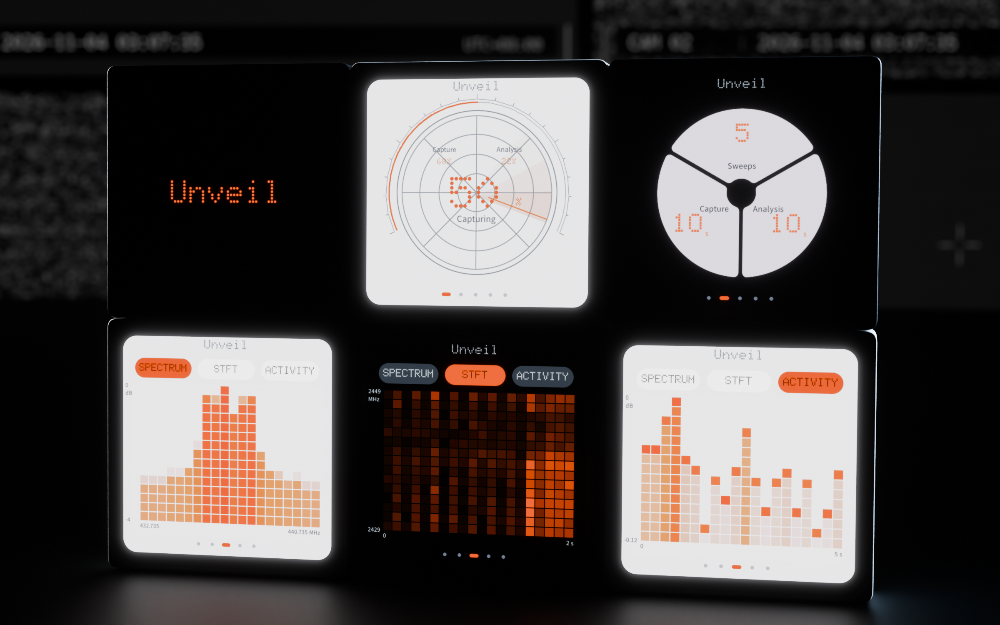

# unveil-panel

**把 ESP-Mosaico 变成手持射频扫描仪控制面板**

Unveil Panel 需要连接运行中的 Unveil 后端。连接后，可以在 480 × 480 触屏上发起扫描、查看进度、浏览信号图表和历史。射频采集和分析由 Unveil 后端执行。

[下载 Idea 固件](https://github.com/aurevoir0216/unveil-panel/releases/latest) · [Unveil 后端接口](docs/backend.md) · [构建与分区](firmware/mosaico-idea/README.md)



## 上手

1. 在 Release 下载名称包含 `idea` 的 `.irisfw`，按 ESP-Mosaico 的 Vibe Mode 更新流程安装。
2. 打开设备上的面板，在 **系统 → Wi-Fi** 连网，在 **系统 → 服务地址** 填写 Unveil 服务器的 HTTP 或 HTTPS 根地址。
3. 在雷达页点 **START**，或短按顶部按键回雷达页并启动扫描。左右滑动切换页面，二级页面向上滑返回。

需要命令行安装时，从已配置好的 [Mosaico Vibe 工作区](https://github.com/esp-mosaico/esp-mosaico-vibe) 运行以下命令。设备标识取自该工作区的 Iris 设备列表。

```sh
python mosaico.py iris system-update --bundle /path/to/unveil-mosaico-idea.irisfw --device-id <device-id>
```

## 界面

| 页面 | 用途 |
| --- | --- |
| 雷达 | 扫描、分阶段进度、检测结果、声音与震动反馈 |
| 圆盘 | 等宽径向档位，调节轮数、采集时长和分析窗口 |
| 图表 | Spectrum 频谱、STFT 时频图和 Activity 相对功率 |
| 历史 | 从 Unveil 后端读取最近记录，切换排序，按记录加载图表 |
| 系统 | Wi-Fi、服务地址、主题、语言、声音和 Vibe Mode 入口 |

## Unveil 后端

设备通过 JSON HTTP 接口发起采集、读取状态并获取图表和历史。服务地址和 Wi-Fi 默认留空。测试模式由 Unveil 后端控制，支持用已有采集数据跑通流程。端点、字段、单位和返回示例见 [Unveil 后端接口](docs/backend.md)。

## 开发

当前维护 **Idea 版**。它保留 Vibe Mode，并在开机时直接进入控制面板。设备构建需要 ESP32-S31 工具链和固定版本的 ESP-IDF。编译与安装包说明见 [Idea 工程](firmware/mosaico-idea/README.md)。

旧桌面版和全盘独立版归档在 [固件目录](firmware/README.md)。
